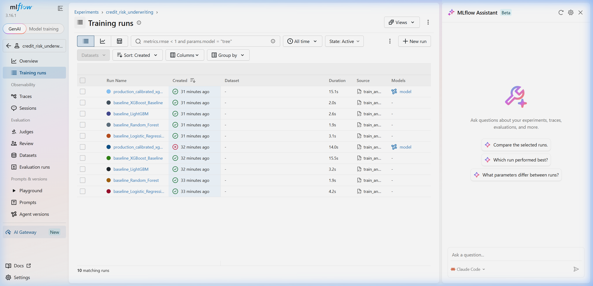
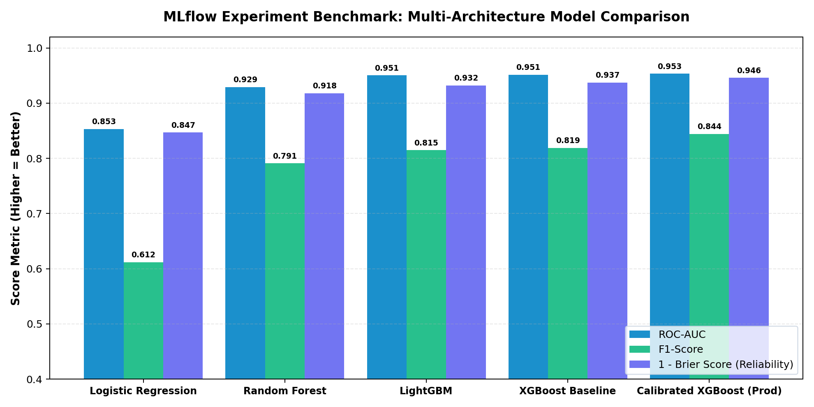

# Credit Risk Prediction

A machine learning project that predicts whether a loan applicant is likely to default on their loan.

The project includes:
- Data cleaning and preprocessing pipeline on 32,000+ loan applications.
- Model training and comparison across Logistic Regression, Random Forest, LightGBM, and XGBoost.
- Experiment tracking with MLflow.
- Feature explanations using SHAP to show what factors raised or lowered the risk.
- A FastAPI backend and an interactive web dashboard (with light and dark mode).

---

## Model Comparison

All models were evaluated on the same 20% test set (6,482 records):

| Model | Accuracy | ROC-AUC | F1 Score |
| :--- | :---: | :---: | :---: |
| Logistic Regression | 78.4% | 0.853 | 0.612 |
| Random Forest | 91.3% | 0.929 | 0.791 |
| LightGBM | 92.0% | 0.951 | 0.815 |
| **XGBoost (Best)** | **93.8%** | **0.953** | **0.844** |

### MLflow Experiment Tracking

Experiments and metrics were tracked with MLflow:





---

## How It Works

1. **Data Preprocessing**: Handles missing values, encodes categories, and calculates features like loan-to-income ratio.
2. **Model Scoring**: The XGBoost model calculates the default risk. If the probability is above 56.8%, the loan is flagged as high risk.
3. **Risk Factors**: Identifies the key features that influenced the decision (such as high loan amount, interest rate, or income).

---

## Project Structure

```
Credit_risk_ML/
├── data/
│   └── credit_risk_dataset.csv     # 32.5k loan records
├── notebooks/
│   └── credit_risk_pipeline.ipynb  # Data exploration and training notebook
├── src/
│   ├── data_pipeline.py            # Data cleaning and feature preprocessing
│   ├── train_and_track.py          # Model training and MLflow tracking
│   └── explainability_and_fairness.py # SHAP explanations and fairness checks
├── app/
│   ├── main.py                     # FastAPI application
│   └── schemas.py                  # API request and response models
├── static/
│   ├── index.html                  # Web dashboard UI
│   ├── style.css                   # Styles (Light & Dark theme)
│   └── script.js                   # Dashboard logic and live calculations
├── artifacts/
│   ├── model.pkl                   # Trained model
│   ├── threshold.pkl               # Decision threshold
│   ├── preprocessor.pkl            # Preprocessing pipeline
│   └── explainer.pkl               # SHAP explainer
├── tests/
│   └── test_api.py                 # API tests
├── Dockerfile                      # Docker setup
├── docker-compose.yml              # Docker compose runner
├── requirements.txt                # Project dependencies
└── README.md
```

---

## Quickstart

### 1. Clone and Install

```bash
git clone https://github.com/ParthG24/Credit_risk_ML.git
cd Credit_risk_ML

# (Optional) Set up a virtual environment
python -m venv venv
venv\Scripts\activate  # On Linux/Mac: source venv/bin/activate

# Install dependencies
pip install -r requirements.txt
```

### 2. Run the Dashboard

```bash
python -m uvicorn app.main:app --host 0.0.0.0 --port 8000 --reload
```

Open your browser and go to:
**http://localhost:8000**

You can test applicant details directly through the dashboard or click the quick presets (e.g., Prime Applicant, High Risk, Borderline).

### 3. Run with Docker (Optional)

```bash
docker compose up --build
```

---

## API Endpoints

- `POST /predict` - Returns loan risk verdict (`Low Risk` or `High Risk`) and default probability.
- `POST /explain` - Returns risk verdict plus top positive and negative factors for that applicant.
- `GET /health` - Health check status.

---

## Running Tests

Run the test suite with pytest:

```bash
python -m pytest tests/ -v
```

---

## License

MIT
