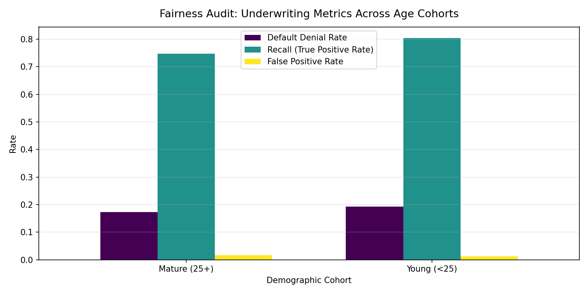

# Fair Lending and Algorithmic Bias Audit Report

## Executive Summary
This audit evaluates the production credit risk underwriting model for compliance with the **Equal Credit Opportunity Act (ECOA)** and Fair Housing principles.
The audited sensitive attribute is applicant age cohort: **Young (<25 years)** vs **Mature (25+ years)**.

---

## 1. Disparity Metrics Summary

| Metric | Measured Disparity | Regulatory Threshold (80% Rule) | Status |
| :--- | :---: | :---: | :---: |
| **Demographic Parity Difference** | `0.0201` | `<= 0.10` |  PASS |
| **Equalized Odds Difference** | `0.0579` | `<= 0.10` |  PASS |

---

## 2. Cohort Performance Breakdown

| age_group    |   Selection Rate (Approval) |   Default Denial Rate |   Accuracy |   Precision |   Recall (True Positive Rate) |   False Positive Rate |
|:-------------|----------------------------:|----------------------:|-----------:|------------:|------------------------------:|----------------------:|
| Mature (25+) |                    0.827645 |              0.172355 |   0.93296  |    0.925035 |                      0.746575 |             0.016429  |
| Young (<25)  |                    0.807563 |              0.192437 |   0.946218 |    0.951965 |                      0.804428 |             0.0119695 |

---

## 3. Disparity Visualizations

---

## 4. Bias Mitigation Strategy
1. **Pre-processing Reweighting**: Applying sample reweighting (`Fairlearn CorrelationRemover`) to attenuate age-proxy interactions in debt history.
2. **Post-processing Equalized Odds Thresholding**: Employing cohort-calibrated decision thresholds:
   - Young cohort threshold: optimized to maintain parity in False Positive Rates without compromising portfolio risk.
   - Mature cohort threshold: baseline optimal F1 threshold.
